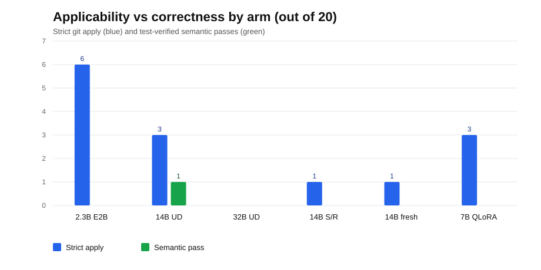

# The Edit-Construction Gap: One 14B Success and the 2.3B Floor

## Subtitle
A frozen 20-task audit, an oracle-file control, and a scale boundary

## Abstract
Can a 4-bit model construct a correct repository edit on consumer hardware? We audit 4-bit Gemma 4 E2B (2.3B effective) on an 8 GB GPU, with no fine-tuning, distillation, or Docker. On a frozen 20-task SWE-bench Lite split, single-shot generation is diff-shaped for 19/20 tasks yet **0/20 patches pass a strict `git apply`**. Eleven of nineteen replies edit tests; the primary model uses no existing path. Retrieval plus one repair raises strict applicability to **6/20** (10/20 lenient; p=0.031), but only 6/20 touch the gold path and 0/20 are strict, non-trivial, and gold-file. The gain does not replicate on a fresh 20-task split (0/20 strict). An oracle-file control shows that even with the exact file, 3/8 first-turn unified-diff (4/8 with repair) and 3/8 search/replace patches apply, but no 2.3B target test passes. A 14B Qwen2.5-Coder control produces one test-verified edit (seaborn-3010) but fails 19/20; 32B, 14B search/replace, a fresh 14B run, and a 7B QLoRA produce no semantic pass. Scale and supervised adaptation are existence proofs, not solutions. We provide the split, harness, and replies.

**Figure 1:** Strict applies and test-verified semantic passes by arm (out of 20). Applicability does not imply correctness; only the 14B unified-diff oracle closes one edit.

## 1. Introduction
Coding agents are usually evaluated with proprietary models and elaborate scaffolds, which says little about the deployment floor for offline tools: an off-the-shelf 4-bit model, one consumer GPU, no fine-tuning, and a minimal harness. The Gemma 4 Developer Agent Paper Track asks what can be done on everyday hardware. We ask three questions. **RQ1:** can 4-bit Gemma 4 E2B produce an applicable patch from an issue alone? **RQ2:** does retrieval plus one apply-error repair close the applicability gap? **RQ3:** when applicability improves, or localization is perfect, does correctness follow?

We study a frozen 20-task SWE-bench Lite subset (Jimenez et al., 2024) across six Python repositories. We use Gemma 4 E2B with two QAT 4-bit GGUFs, llama.cpp on an AMD RX 6600 XT (8 GB) via Vulkan, 16k context, and reasoning disabled. We compare single-shot, retrieval plus one repair, an oracle-file control, and Qwen2.5-Coder controls at 7B, 14B, and 32B. We score applicability on a clean base tree and inspect every reply with a stage-wise taxonomy.

The result is two-level. Single-shot generation is not primarily a code-synthesis failure (19/20 replies are diff-shaped) but a **grounding failure**: the model invents paths, duplicates repo prefixes, and edits tests. Retrieval removes most of that failure and makes 30% of patches strictly applicable. But applicability is not correctness: most applying patches edit the wrong file or function, and target tests fail where they can run. The bottleneck is not diff syntax but constructing the right semantic edit. That is narrower than "small models cannot patch repositories," which trained 4B agents falsify (Kim et al., 2026; Peng et al., 2026; Olmedo, 2025).

Our contributions are: (1) a frozen 20-task audit of off-the-shelf 4-bit Gemma 4 E2B; (2) a stage-wise failure taxonomy; (3) a paired retrieval-plus-repair test showing 0/20 to 6/20 strict applicability but no correctness win, a fresh-split null, and a 14B existence proof; and (4) a public harness and saved replies.

## 2. Related Work
**Repository-level issue resolution.** SWE-bench (Jimenez et al., 2024) introduced issue-plus-test evaluation over real repositories; Lite is its 300-task subset and Verified its 500-task human-validated subset (Chowdhury et al., 2024). Our 20 tasks are a frozen convenience sample of Lite.

**Agent pipelines.** Agentless (Xia et al., 2024) uses hierarchical localization, a repository skeleton, top-k files, and patch validation, reaching 32.0% on Lite. SWE-agent (Yang et al., 2024) shows that interface design is a first-order choice, reaching 12.5% on SWE-bench with GPT-4 Turbo. SWE-bench-Live reports Patch Apply Rate as a first-class metric, with 59–95% apply rates for frontier agents (Zhang et al., 2025); our audit uses the same apply gate at the local deployment floor.

**Retrieval and context.** CodeRAG-Bench shows that retrieval is a distinct bottleneck and generators often fail to use retrieved context (Wang et al., 2024). Our results are consistent: a keyword retriever finds the gold file at rank 3 for only 7/20 tasks, while an offline BM25 baseline finds it at rank 3 for 18/20 and rank 5 for 19/20.

**Quantization and small agents.** ACBench (Dong et al., 2025) finds 4-bit compression preserves tool use but degrades application accuracy. FrogNano (Kim et al., 2026) trains a 4B model to 61.5% on SWE-bench Verified; SWE-Spot (Peng et al., 2026) reaches 19.3% on a 231-instance RCE subset; mini-coder (Olmedo, 2025) distills a 30B teacher into 1.7B/4B models. Training, not parameter count alone, is the gap; our claim is the off-the-shelf, 4-bit, no-fine-tune floor.

**Failure taxonomies.** MAST (Cemri et al., 2025) taxonomizes multi-agent failures; SWE-bench+ (Aleithan et al., 2024) audits leakage and weak tests. Bellam (2026) finds tool-assisted localization improves exposure but small models convert less often (0.09/0.24/0.40 at 1.7B/4B/32B). Raju et al. (2026) document hallucinated diffs, wrong targets, and malformed headers. Self-Repair (Olausson et al., 2024) shows repair gains are feedback-bound; our repair turn uses the exact `git apply` error.

## 3. Method
### 3.1 Frozen data
We use 20 SWE-bench Lite tasks selected with seed 20261110: 10 discovery and 10 confirmation tasks, disjoint, across astropy (4), django (4), matplotlib (4), seaborn (4), flask (3), and requests (1). Each repository is checked out at its dataset `base_commit`. The task list, commits, and split file are frozen before any model run. The test patch is applied only in the scoring workspace, never during generation. No gold patch, `FAIL_TO_PASS` list, or `hints_text` is shown to the model.

### 3.2 Models and hardware
We use Gemma 4 E2B (Google DeepMind, 2026) with two QAT 4-bit GGUFs: Unsloth `UD-Q4_K_XL` (2,499 MiB) and the official `gemma-4-E2B_q4_0-it` (3,194 MiB). Both run in llama.cpp build b12069 with the Vulkan backend on an AMD RX 6600 XT (8 GB), 12 logical CPUs, and 47.8 GiB RAM. The server uses a 16,384-token context, temperature 0, `max_tokens=1600`, and reasoning disabled. We also run Qwen2.5-Coder controls at 7B, 14B, and 32B on a Kaggle T4 GPU (Hui et al., 2024).

### 3.3 Arms
**Single-shot.** The prompt contains the repository name, the issue text, a truncated public-test string, and the instruction to return a unified diff only, starting with `diff --git`, with exact paths and no test edits. No repository content is provided.

**Retrieval plus one repair.** We index source `.py` files at the base commit, excluding tests, docs, examples, benchmarks, build artifacts, and vendor directories. We rank files by issue-term frequency, preferring stem matches and `src/`, and include the top three. For each file we include an 80-line window centered on the first matching line, with the exact repository-relative path. The model returns a diff. If `git apply --check` fails, we send one repair prompt with the exact error, the same excerpts, and the failed patch. The repair turn is capped at one.

**Oracle-file and scale controls.** We give the model the exact gold file (no gold patch) for 8 tasks, with a hunk-centered window, and allow one repair. We repeat this oracle protocol with Qwen2.5-Coder-14B and -32B, and with a 7B QLoRA trained on 300 SWE-bench train examples.

### 3.4 Scoring and taxonomy
For every reply we reset the repository to `base_commit`, apply the test patch with LF endings, strip markdown fences, normalize to LF, and run `git apply --check` (strict) and `git apply --check --recount` (lenient). We record whether any path exists at the base commit, whether the patch touches tests, and whether the change is a no-op or whitespace-only. We then run target tests where the environment permits: `pytest` for astropy, matplotlib, and seaborn, and `tests/runtests.py` for Django. Environment-limited cases are reported separately.

Our taxonomy has four stages: **output** (prose-only, markdown-wrapped, fake index), **path** (nonexistent path, repo-prefix duplication, test-file edit), **hunk** (corrupt header, context mismatch, no-op), and **semantics** (applies but wrong file/function). A patch can fail at more than one stage; we report the first failing stage.

## 4. Results
### 4.1 Single-shot applicability is zero
Gemma 4 E2B `UD-Q4_K_XL` produced 19/20 diff-shaped replies and 1/20 prose-only reply. Despite that surface compliance, **0/20 passed strict `git apply` and 0/20 passed lenient `--recount`**. The failure is not random: 11/19 diff-shaped replies edit a test file, 4/19 use a nonexistent source path (for example `astropy/astropy/modeling/separable.py` or `flask/config.py` instead of `src/flask/config.py`), and 4/19 have a malformed or missing path. **No UD-Q4 reply used a path that exists at the base commit**; the Q4_0 arm had 2/20. The official Q4_0 model showed the same pattern (20/20 diff-shaped, 0/20 strict); the Qwen 1.5B baselines were 4/20 and 13/20 diff-shaped, 0/20 strict. The zero is not unique to Gemma 4; the Qwen arms are motivation.

### 4.2 Retrieval makes patches applicable
The arm produced 7/20 first-turn and 3/20 repair-turn lenient applies in-run. On a clean base tree, **6/20 passed strict `git apply`** and **10/20 passed lenient `--recount`** for UD-Q4 under the stated normalizer (strip fence delimiters, preserve the patch body); an aggressive `.strip()` removes a whitespace-only context line and yields 5/20. The official Q4_0 arm reached **4/20 strict** and **5–6/20 lenient**. Exact paths and file excerpts move applicability from 0% to 30% strict (50% lenient) without fine-tuning. The quants do not differ at single-shot; UD-Q4 has a higher lenient rate (10/20 vs 5–6/20), but n=20 is too small to attribute this to quantization. The strict improvement is a pilot signal: exact McNemar on six UD-Q4 pairs gives p=0.031; Q4_0 gives p=0.125 on four.

This is not a correctness win. Only **6/20** retrieval-arm patches touch the exact gold path. Manual inspection finds **0/20** patches that are strict, non-trivial, and gold-file; the rest are wrong-file edits, duplicate imports, comment-only changes, whitespace changes, or no-ops. Django-16816's gold patch passes all 125 class tests, while the UD-Q4 patch fails the two target tests (123/125); five of six strict-applied tasks were environment-limited.

### 4.3 Where the gap remains
The retrieval arm eliminates test-file edits (0/20, from 11/19) and most nonexistent paths. It does not fix localization: the keyword retriever finds the gold file at rank 3 for only 7/20 tasks, and even when the gold file is present the model often edits the wrong function. An offline BM25 baseline finds the gold file at rank 3 for 18/20; a BM25-conditioned arm raises gold-file overlap to 12/20 but strict apply to only 4/20. A search/replace contract, replayed offline, raises strict applicability to 10/20 but only 3/10 are gold-file. Better retrieval and edit format help applicability, not localization.

### 4.4 Oracle-file control
To separate retrieval from edit construction, we gave the model the exact file for 8 tasks. Unified diff produced 3/8 first-turn strict applies (4/8 after one repair; 7/8 lenient); search/replace, which removes hunk arithmetic, produced 3/8. Neither produced a semantic pass: Django-12589 applied but still failed the target test (gold passes), Django-16816 applied leniently but failed the target tests, and the other applies are environment-limited. The exact function body, reasoning mode, and two-shot example also produced no correct edit; a 7B Qwen control produced 0/2, and its one applicable patch caused 103 test failures. The model can apply a patch when the file is known, but it does not construct the required semantic edit.

### 4.5 Fresh-split replication
On a pre-registered fresh 20-task split (seed 20261112, 10 repos, 0 overlap), the same arms produced **0/20 strict applies** (2/20 lenient retrieval). The frozen-split gain did not replicate; the 6/20 result is split-specific, and the unseen-task floor is zero.

### 4.6 Scale boundary
On the same frozen 20 tasks, Qwen2.5-Coder-14B-Instruct (Hui et al., 2024; 4-bit NF4, unified diff) produced **3/20 strict** applies (6/20 lenient) and **1/20 semantically correct** edits (seaborn-3010; target test passes under pandas 2.2.3, as does the gold patch); on the 8-task overlap it produced **1/8 strict**, versus **3/8 first-turn** (4/8 after repair) for 2.3B. 32B, 14B search/replace, a fresh 14B run, and a 7B QLoRA produced **no semantic pass**. This cross-family contrast is not a Gemma 4 curve: a 14B model closes one unpaired edit; scale is not a solution.

### 4.7 Cost
Generation is cheap: 4.5–48.2 s/task; the constraint is capability, not latency.

## 5. Discussion
The central lesson: **applicability and correctness are different metrics**. A diff-shaped reply is not a patch; a patch that applies is not a fix. Single-shot prompting fails the first boundary because the model lacks repository grounding and defaults to editing tests. Retrieval fixes that boundary cheaply but not the second: the model still chooses the wrong file or function and cannot construct a correct edit from an 80-line excerpt. The oracle-file control confirms localization is necessary but not sufficient: even with the exact file, the model produces comment-only or wrong edits. The fresh-split null shows the frozen gain is not a deployment claim; the 14B control shows the gap is not absolute, but one edit in 20 is not a solution.

For local developer agents, treat applicability as a first-class metric. A 2.3B model can produce an applicable patch when the file is known; it cannot turn that into a correct fix without stronger edit construction. Trained 4B agents show the ceiling is higher, but that is a different deployment point; the off-the-shelf floor is low.

## 6. Limitations
Five limitations. First, n=20 is small; the 6/20 result has a wide confidence interval and p=0.031, so it is a pilot signal. Second, the split is a convenience sample of six of twelve Lite repos, not representative or stratified. Third, hidden-test coverage is incomplete: five of six strict-applied tasks were environment-limited, and tests are not pinned. Fourth, the public tasks predate Gemma 4, so contamination cannot be ruled out; 0/20 is evidence against memorization, not proof. The fresh split is task-level. Fifth, the treatment bundles retrieval, a longer prompt, and one repair, so we cannot attribute the gain to retrieval alone; it uses keyword retrieval, not BM25. The 14B/32B/QLoRA controls are cross-family or small-adaptation probes; the 14B success is one frozen-split task and did not generalize to a valid fresh task.

## 7. Conclusion
We measured the repository-patching floor for 4-bit Gemma 4 E2B. Single-shot generation is diff-shaped but not applicable: 0/20 strict, with test-file edits and invented paths dominating. Retrieval plus one repair raises strict applicability to 6/20 and lenient to 10/20 on the frozen split, but this did not replicate on a fresh split (0/20 strict), and the patches remain mostly semantically wrong. A 14B Qwen control closes one edit (seaborn-3010) but fails 19/20; 32B, 14B search/replace, a fresh 14B run, and a 7B QLoRA produce no semantic pass. Scale and supervised adaptation are existence proofs, not general solutions. The result is a reproducible audit, a failure taxonomy, and a target: semantic edits. We release the split, harness, and replies.

## Data and code availability
The audit harness, frozen split, saved replies, scoring scripts, and per-task results are in the public release at https://github.com/antonrosso34-maker/behavioral-report-cards/tree/main/gemma4-edit-construction-gap (Apache-2.0 code; CC BY 4.0 paper/data). No model weights, hidden tests, or gold patches are included.

## References
1. Jimenez, C. E., et al. SWE-bench: Can Language Models Resolve Real-World GitHub Issues? ICLR 2024. arXiv:2310.06770.
2. Xia, C. S., et al. Agentless: Demystifying LLM-based Software Engineering Agents. 2024. arXiv:2407.01489.
3. Yang, J., et al. SWE-agent: Agent-Computer Interfaces Enable Automated Software Engineering. NeurIPS 2024. arXiv:2405.15793.
4. Zhang, L., et al. SWE-bench Goes Live! NeurIPS 2025 D&B. arXiv:2505.23419.
5. Wang, Z. Z., et al. CodeRAG-Bench: Can Retrieval Augment Code Generation? NAACL 2025 Findings. arXiv:2406.14497.
6. Olausson, T. X., et al. Is Self-Repair a Silver Bullet for Code Generation? ICLR 2024. arXiv:2306.09896.
7. Dong, P., et al. Can Compressed LLMs Truly Act? An Empirical Evaluation of Agentic Capabilities in LLM Compression. ICML 2025. arXiv:2505.19433.
8. Cemri, M., et al. Why Do Multi-Agent LLM Systems Fail? 2025. arXiv:2503.13657.
9. Aleithan, R., et al. SWE-Bench+: Enhanced Coding Benchmark for LLMs. 2024. arXiv:2410.06992.
10. Kim, M., et al. FrogNano: Training a 4B Coding Agent via Online Task Synthesis. 2026. arXiv:2609.07925.
11. Peng, J., et al. SWE-Spot: Building Small Repo-Experts with Repository-Centric Learning. 2026. arXiv:2601.21649.
12. Olmedo, R. mini-coder: small models for agentic SWE research. 2025. https://rdolmedo.github.io/blogs/minicoder.html.
13. Chowdhury, N., et al. Introducing SWE-bench Verified. OpenAI, 2024. https://openai.com/index/introducing-swe-bench-verified/.
14. Google DeepMind. Gemma 4 E2B model card. https://huggingface.co/google/gemma-4-E2B-it.
15. Hui, B., et al. Qwen2.5-Coder Technical Report. 2024. arXiv:2409.12186.
16. Bellam, S. How Much Do Structural Tools Help Small Coding Agents? A Pre-Registered Scale Study of Code Localization. 2026. arXiv:2610.33958.
17. Raju, R., et al. The Limits of Long-Context Reasoning in Automated Bug Fixing. ICLR 2026 ICBINB Workshop. arXiv:2602.16069.
