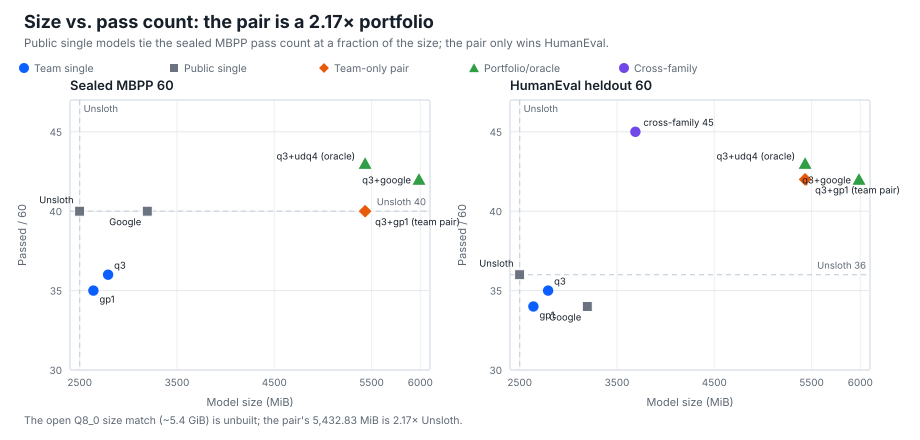
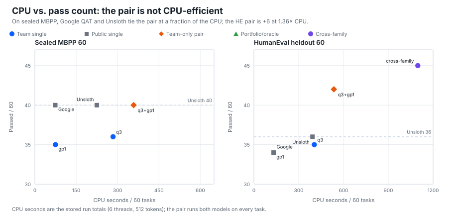
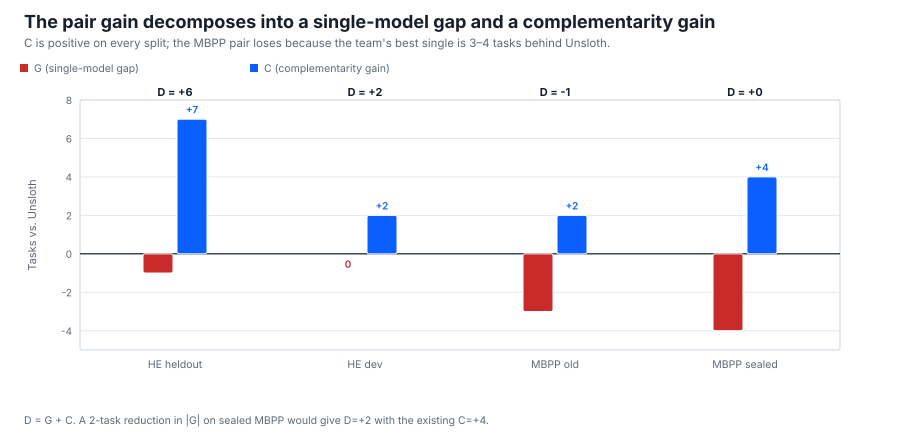
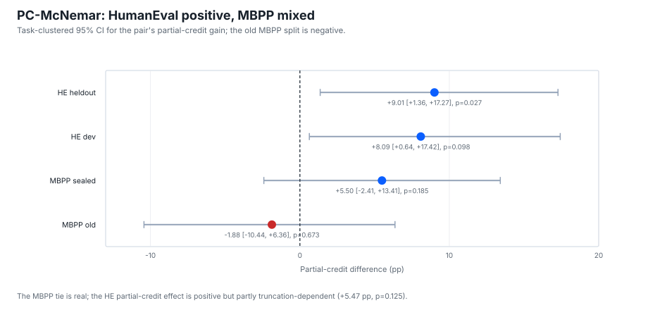

# Pass-Set Complementarity in Quantized Code Models: A Two-Family Audit with Size and Transfer Boundaries

**Authors:** Anton Rosso  
**Affiliation:** Independent research release  
**Date:** 2026-11-11  
**Keywords:** quantized code models; pass-set complementarity; transfer boundary; HumanEval; MBPP.

**Status:** Final paper (2026-11-11). Repair@1 is post-hoc; the HumanEval pair is a portfolio at 2.17×; no size-matched single-model win.

## Abstract

Quantization selection is usually driven by weight error or perplexity, but deployment is judged by which tasks a configuration passes. We use the pass set as an audit primitive, then study Gemma E2B against Unsloth UD-Q4. The HumanEval pair is 42/60 vs 36/60 (b=7, c=1, one-sided p=0.0352; partial credit +9.01 pp, p=0.027) at 2.17×; the sealed MBPP is 40/60 vs 40/60 (a real tie); the old MBPP is 34/60 vs 35/60 (a loss); a deterministic repair@1 development result is 44/60 vs 40/60 (b=4, c=0, p=0.0625, post-hoc); a size-matched 2,492.99 MiB model is a dev win (+5, p=0.0898) and heldout near-tie (−2); a cross-family pair is 45/60 vs 36/60 (p=0.0059, 1.476×, HumanEval-only). The contribution is a two-family complementarity audit with D=G+C, a failure-correlation mechanism, and a claim/counter-theory certificate. No size-matched single-model win; no generic repair; no PC@1 win.

## 1. Introduction

Quantized code models are usually selected by weight error or perplexity, but deployment is judged by which tasks a configuration passes. The pass set stores in 8 bytes (60 tasks) or 10 (80). The prior report-card study used this bitset as an audit artifact: pair/union queries are exact within the observed matrix but do not transfer; the header is a report card, not a selector.

This paper asks whether a team's quantized model can beat a strong public baseline at a declared size. We study Gemma E2B against Unsloth UD-Q4_K_XL (2,498.98 MiB). The team pair wins HumanEval heldout (42/60 vs 36/60, p=0.0352; partial credit +9.01 pp, p=0.027) at 2.17×, ties the sealed MBPP (40/60 vs 40/60), and has a post-hoc repair@1 result (44/60 vs 40/60, p=0.0625). The size-matched 2,492.99 MiB model is a dev win (+5, p=0.0898) and heldout near-tie (−2). A cross-family pair is the strongest p-value (45/60 vs 36/60, p=0.0059) but is HumanEval-only and 1.476×.

The contribution is a **two-family complementarity audit**: the report card primitive, \(D=G+C\), a failure-correlation mechanism, and a claim/counter-theory ledger. The headline is the HumanEval pair plus the boundary; the next test is the HE-primary Fresh-132.

## 2. Related Work

GPTQ, AWQ, SpQR, k-quants, AMQ, CompressionBench, LLM-KICK, and ACBench show that weight error and perplexity can miss capability. Yang et al. (2024) use natural-language report cards; our unit is the exact pass set. Li et al. (2024) evaluate aggregate performance, not per-configuration complementarity.

Four lines matter: **quantization ensembles/model soups** (Wortsman et al., 2022; Lakshminarayanan et al., 2017) for same-base-model complementarity; **cascades/selectors** (FrugalGPT, 2023; RouteLLM, 2024) for the oracle-vs-deployment gap; **non-inferiority** (McNemar, 1947; Piaggio et al., 2006) for the near-tie; and **QAT vs PTQ** (Unsloth UD-Q4_K_XL; Google QAT Q4; imatrix) for the recipe confound.

## 3. Method

### 3.1 Audit primitive

For a configuration \(c\), the pass set \(P_c\) is the set of probes it passes under a fixed protocol; the probe passport records the execution. The bitset is **8 bytes for 60 tasks**, **10 bytes for 80**. Pair/union queries are exact **within the observed matrix**; the header is not a selector.

### 3.2 Two-family protocol

The Gemma E2B matrix has five configurations (`q3_mix`, `google_qat_q4_0`, `gp1_qat_requant`, `udq4_k_xl`, `udq2_k_xl`) and three splits (HE dev 40, HE heldout 60, MBPP heldout 60). Unsloth UD-Q4_K_XL is 2,498.98 MiB (SHA `e531007…`). The protocol is temperature 0, context 2048, f16 KV, 512 tokens, 30 s. The 512-token cap is a confound: truncated generations fail on heldout/MBPP/sealed; q3_mix truncates 17/60 vs Unsloth 12/60. The truncation-adjusted upper bound is q3 52, gp1b 49, Unsloth 48.

### 3.3 Claim ladder and statistics

We use five rungs: **L0** within-sample report card; **L1** split-half/cross-matrix boundary; **L2** fresh-split replication; **L3** size-matched single-model win; **L4** deployable selector. The exact McNemar endpoint is one-sided team superiority \(p_1=P(\mathrm{Bin}(b+c,0.5)\ge b)\), where \(b\) is team-only and \(c\) is Unsloth-only; the two-sided value is \(p_2=2\min(P(\ge b),P(\le b))\). The paired bootstrap resamples tasks, not tests. For partial credit we run each base assertion and each MBPP+ plus input individually and report the task-clustered CI, sign-flip p, ICC, effective sample size, and cluster-robust McNemar.

**p-value arithmetic.** For old MBPP (b=4, c=5): \(P(\mathrm{Bin}(9,0.5)\ge4)=382/512=0.7461\); \(P(\le4)=256/512=0.5000\); two-sided 1.0000. For gp1b heldout (b=3, c=5): \(P(\mathrm{Bin}(8,0.5)\ge3)=219/256=0.8555\); \(P(\le3)=93/256=0.3633\); two-sided 0.7266. The paper reports the team endpoint; 0.5000 and 0.3633 are the lower tails in the opposite direction.

### 3.4 Repair@1

The repair layer is a deterministic operator table applied to every arm: `missing_return` (123 q3), `builtin_shadow` with `import builtins` (126), `trailing_demo_strip` (308), `redundant_block` (635 gp1), `formula_lookup` (135), and `predicate_swap` (459 q3). Caveats: 126 is two lines; 635's plus suite is all `[[]]`; gp1 459 still fails; `continuation` is excluded. The full 197-failure sweep replays 480/480 stored verdicts. On the 66 Gemma-fresh MBPP tasks scored by Qwen, the library fixes 3/118 (2.54%), all `formula_lookup` on `Mbpp/59`; this is a Qwen proxy, not a Gemma result.

### 3.5 Fresh-132 and counter-theory ledger

The 160-task MBPP plan is infeasible. The fresh pool is 68 MBPP + 64 HE = 132, but the 64 HE and 76 MBPP `stage2_cal` tasks were Qwen-scored on 2026-11-08; strict unseen is 2 MBPP + 0 HE. The only feasible significant fresh claim is HE-primary superiority plus MBPP non-inferiority. At n=132 the 80% MDE is 9.4 pp/12.4 tasks; +2/60 has power 0.120, +6/60 0.859. HE-64 at +6/60 is 57.95% one-sided; the target is ≥+8 (82.8%). MBPP +2/60 is 20.0% one-sided; only +6/60 reaches 92.2%. The NI margin is ≥−8 pp at n=68 or ≥−5 pp at n=132. The counter-theory ledger covers pair size, MBPP noise, split-specificity, oracle/deployment, QAT/PTQ, the 512-token cap, size, Google QAT, weak tests, and release license/DOI.

## 4. Results

### 4.1 Audit primitive and boundary

| Evidence | Result |
|---|---|
| Exact header 8 B/60, 10 B/80 | 0.00 regret, 0.0000 MAE, 1.00 top-3; CP@1 0.6376/0.6532; selection coverage 1.000; 31/60 complement contributes 5 unique tasks |
| Split-half | 1.91/1.70 regret, 3.00/3.47 MAE, 0.208/0.079 top-3; config stability 40.5%/41.1% |
| Cross-matrix | 48/80 vs 56/80; 34/60 vs 39/60; KV8 adds 0 |
| CP40 panel | 18/40 vs 17/40 (+1), one-sided p=0.5; MBPP subgroup 0 gain; CP@1 0.4199/0.4190 |
| Gemma transfer | storage exact (5 B/40, 8 B/60); target-best 0/6; regret 1–6; transfer fails |

The report card is exact within-sample, not a selector; the new audit uses it as the measurement unit.

### 4.2 The Gemma E2B duel

| Arm / pair | Size (MiB) | HE heldout | HE dev | MBPP old | MBPP sealed |
|---|---:|---:|---:|---:|---:|
| Unsloth UD-Q4_K_XL | 2,498.98 | 36/60 | 29/40 | 35/60 | **40/60** |
| `q3_mix` | 2,792.09 | 35/60 | 25/40 | 30/60 | 36/60 |
| `gp1_qat_requant` | 2,640.74 | 34/60 | 29/40 | 32/60 | 35/60 |
| `q3+gp1` pair | 5,432.83 (2.17×) | **42/60** | 31/40 | 34/60 | 40/60 |
| `q3+google` pair | 5,986.44 (2.40×) | 42/60 | 33/40 | 36/60 | 42/60 |

**Roles.** `q3_mix`, `gp1_qat_requant`, and `gp1b_2498` are team builds; `google_qat_q4_0` (Google) and `udq4_k_xl` (Unsloth) are public baselines. `q3+gp1` is the team-only pair; `q3+google` is a team-led portfolio with a public Google complement.

The sealed pair is a **real tie** (40/60 vs 40/60, b=4, c=4, one-sided p=0.6367); the old MBPP pair is a **loss** (34/60 vs 35/60, b=4, c=5, one-sided p=0.7461, two-sided 1.0000); the HumanEval pair is a **win** (42/60 vs 36/60, b=7, c=1, one-sided p=0.0352, two-sided 0.0703). The non-Unsloth `q3+google` pair is 42/60 vs 40/60 on sealed (b=4, c=2, p=0.3438, INCONCLUSIVE); `q3+udq4` is 43/60 (b=3, c=0, p=0.125); the all-four oracle is 44/60.

### 4.3 Decomposition \(D=G+C\)

For each split, \(D=P-U=(B-U)+(P-B)=G+C\), where \(U\) is Unsloth, \(B\) the best team single, and \(P\) the pair union.

| Split | U | B | P | G | C | D | Verdict |
|---|---:|---:|---:|---:|---:|---:|---|
| HE heldout 60 | 36 | 35 | 42 | **−1** | **+7** | **+6** | win |
| HE dev 40 | 29 | 29 | 31 | **0** | **+2** | **+2** | win |
| MBPP old 60 | 35 | 32 | 34 | **−3** | **+2** | **−1** | loss |
| MBPP sealed 60 | 40 | 36 | 40 | **−4** | **+4** | **0** | tie |

C is positive on all four splits (+2 to +7); G is zero or negative (0 to −4); the pair wins iff C > |G|. The MBPP failure is a single-model-gap failure, not a complementarity failure. The campaign target is to reduce |G| on MBPP by 2 tasks (sealed: −4 → −2 gives D=+2 with C=+4), not to increase C.

### 4.4 Repair@1 development result

The full sweep gives team pair **+4 old / +4 sealed**, Unsloth **0/45**, Google **0/45**; 184/197 failures have no matching operator. The sealed pair is **44/60 vs 40/60**, b=4, c=0, **p=0.0625**; the old pair is **38/60 vs 35/60**, b=4, c=1, **p=0.1875**. The 4/4 requires the import-inclusive `builtins.sum` guard for `Mbpp/126`; the 3/4 fallback is 43/60, p=0.1875. The result is **post-hoc** and operation-specific. The fresh 68-task MBPP panel needs **k≥4 repair-only tasks and 0 Unsloth repairs** for p<0.10; under the Qwen-proxy rate, expected yield is 1.73 fixes and **P(≥4)=9.5%**. The 32-task screen ≥+2 has P=19.5%. This is a high-risk confirmation; do not lead with it.

### 4.5 PC-McNemar: task-family-specific

| Split | Pair binary | Mean paired difference | Task-clustered 95% CI | Sign-flip p | Cluster-robust p |
|---|---|---:|---:|---:|---:|
| HE heldout | 42/60 vs 36/60 | **+9.0068 pp** | **[+1.3603, +17.2729]** | **0.0268** | **0.0209** |
| HE dev | 31/40 vs 29/40 | +8.0916 pp | [+0.6352, +17.4245] | 0.0977 | 0.0825 |
| MBPP sealed | 40/60 vs 40/60 | +5.4956 pp | [−2.4113, +13.4136] | 0.1851 | 0.1758 |
| MBPP old | 34/60 vs 35/60 | **−1.8762 pp** | [−10.4350, +6.3644] | 0.6733 | 0.7136 |

The MBPP tie is real on both splits; the MBPP partial-credit claim is dead. The HE effect is positive at both levels; the endpoint is task-family-specific. Truncation exclusion reduces the heldout effect to +5.47 pp, CI [+0.0105, +13.2016], p=0.1249; it survives in direction but is partly truncation-dependent. The high ICC (0.82/0.85) leaves ~71 effective units; the naive test-case p is a clustering artifact.

### 4.6 Size-matched and cross-family results

`gp1b_2498` is **2,492.99 MiB**, 6 MiB smaller than Unsloth. Dev: **34/40 vs 29/40**, b=7, c=2, p=0.0898, bootstrap CI (−1, 11). Heldout: **34/60 vs 36/60**, b=3, c=5, one-sided p=0.8555, two-sided 0.7266, CI (−8, 3); 15/60 truncations, truncation-adjusted upper bound 49 vs 48. MBPP partial: **17/32 vs 20/32**. This is a dev win + heldout near-tie, not a heldout win; the MBPP axis is worse. At matched pass count on sealed MBPP, the single `google_qat_q4_0` model ties the pair (40/60) at 3,194.35 MiB and 74.06 s vs the pair's 5,432.83 MiB and 358.19 s; the pair is a portfolio result, not a single-agent win. Appendix G of the release document reports the full matched-resource table.

The cross-family `gp1_2629 + q5ks_none` pair is **45/60 vs 36/60**, b=10, c=1, p=0.0059, at **1.476×**. The Gemma arm is 34/60, the Qwen arm 33/60; the union has 11+12 unique tasks. Both individually lose to Unsloth (34 and 33 vs 36); the pair wins by +9. It is HumanEval-only and 1.476×; a secondary portfolio result, not a size-matched single model.

### 4.7 Failure correlation and headroom

The four-arm regression (24 points) gives **Spearman(pass correlation, C) = −0.8095**: higher failure correlation goes with lower pair gain. The q3/gp1 MBPP pair is the high-correlation/low-gain case; q3/google and q3/udq4 are lower-correlation/higher-gain; gp1/google is the extreme.

Headroom capture `(pair union − Unsloth)/(oracle − Unsloth)`: team-only `q3+gp1` is 33% dev, 75% heldout, **−20% old MBPP**, **0% sealed**; `q3+google` is 67%/75%/20%/50%; `q3+udq4` is 33%/88%/40%/75%. The team-only pair is never the best capture; the constraint costs 2 tasks on dev, sealed, and old MBPP.

### 4.8 Fresh-132 power

The fresh pool is 68 MBPP + 64 HE = 132, but the 64 HE and 76 MBPP `stage2_cal` tasks were Qwen-scored; strict unseen is 2 MBPP + 0 HE. HE-64 at +6/60 is 57.95% one-sided; the target is ≥+8 (82.8%). MBPP +2/60 is 20.0% one-sided. The NI margin is −8 pp at n=68 or −5 pp at n=132. The only feasible significant fresh claim is HE-primary + MBPP non-inferiority, on a genuinely unseen or campaign-fresh panel.

## 5. Discussion

The audit has a clear practical reading. On sealed MBPP, the pair is **not a better single agent**: Google QAT and Unsloth tie 40/60 at 3,194/2,499 MiB and 74/225 s, while the pair uses 5,433 MiB and 358 s. On HumanEval, the pair is +6 over Unsloth, but at 2.17× size and 1.36× CPU; the single Unsloth is more pass/CPU-efficient (0.0917 vs 0.0785). The pair is a portfolio, not a size- or CPU-matched single-model win. The D=G+C decomposition explains why: C is positive on every split, but the MBPP single-model gap G is −3/−4. The next tests are a size-matched Q8_0 (~5.4 GiB) and a CPU-matched q3/Unsloth at 1024 tokens; the current pair fails the ≤1.1× size/CPU rule.

| Worked | Did not work / not claimed |
|---|---|
| Exact pass-set audit (8 B/60, 10 B/80); HE pair 42/60 vs 36/60; D=G+C; failure correlation −0.81; matched resources | Size-matched single-model win; generic repair; PC@1 win; team-only portfolio win; cross-family MBPP; fresh panel from Qwen-used tasks; matched-size build >40/60 |

## 6. Limitations and claims not made

The panels are 60 tasks (40 dev); the 512-token cap is a confound; the QAT/PTQ confound is explicit; the repair is post-hoc and operation-specific; the PC@1 is split-specific; the Fresh-132 is Qwen-used; the pair is 2.17×; the cross-family pair is HumanEval-only. The 126 repair needs `import builtins`; the 635 plus suite is all `[[]]`; gp1 `Mbpp/459` still fails. **Claims not made:** no size-matched single-model win at ≤2,499 MiB; no PC@1 win; no generic repair; no team-only portfolio win; no cross-family MBPP; no fresh-panel result from the Qwen-used 132; no matched-size build win; no SOTA/compression/Pareto claim; no out-of-sample exactness.

## 7. Conclusion

The report card is exact within-sample (8 B/60, 10 B/80; 0.00 regret, 0.0000 MAE, 1.00 top-3; CP@1 0.6376/0.6532; the 31/60 complement contributes 5 unique tasks). It does not transfer: split-half, cross-matrix, KV8, CP40, and Gemma fail. The report card is an audit artifact, not a selector.

The two-family audit shows a real HumanEval complementarity: 42/60 vs 36/60 (b=7, c=1, one-sided p=0.0352; partial credit +9.01 pp, p=0.027) at 2.17×; the sealed MBPP is a real tie (40/60 vs 40/60); the repair@1 development result is 44/60 vs 40/60 (b=4, c=0, p=0.0625, post-hoc); the size-matched gp1b is a dev win (+5, p=0.0898) and heldout near-tie (−2); the cross-family pair is 45/60 vs 36/60 (p=0.0059, 1.476×, HumanEval-only). The best public claim is the HumanEval pair plus the boundary; the next test is the HE-primary Fresh-132; the repair is a high-risk secondary; there is no size-matched single-model win. 

## Data and code availability

Public release: [behavioral-report-cards](https://github.com/antonrosso34-maker/behavioral-report-cards) (v1.1.0). Individual pass matrices, task IDs, and sanitized summaries: [evidence/gemma-audit](https://github.com/antonrosso34-maker/behavioral-report-cards/tree/main/evidence/gemma-audit). Report-card manifest and demo: [data/pass-set-header](https://github.com/antonrosso34-maker/behavioral-report-cards/tree/main/data/pass-set-header), [data/report-card](https://github.com/antonrosso34-maker/behavioral-report-cards/tree/main/data/report-card). Full release document: [FINAL_PAPER_RELEASE_V1.md](https://github.com/antonrosso34-maker/behavioral-report-cards/blob/main/paper/FINAL_PAPER_RELEASE_V1.md). Model: [Hugging Face](https://huggingface.co/AntonROSSO/qwen2.5-coder-1.5b-mx2-aq6-q3ks). 

## Reproducibility

Verify the release with `cd evidence/gemma-audit && sha256sum -c SHA256SUMS` and the top-level `sha256sum -c SHA256SUMS`; the report-card demo is `python data/report-card/report_card.py --help`. The paper's numbers are from the stored JSONLs; no new scored run was used.

## Artifacts and references

The full release document with all figures, full references with URLs/DOIs, appendices and release checklist is [FINAL_PAPER_RELEASE_V1.md](https://github.com/antonrosso34-maker/behavioral-report-cards/blob/main/paper/FINAL_PAPER_RELEASE_V1.md). Full references with URLs/DOIs are in that document's §References.

**No new scored run, server, lock, GPU, new session, or commit was used in this draft.**
